# 🎭 Facial Emotion Recognition

<p align="left">
  
  
  
  
  
  
  
</p>

## 🧾 Ringkasan

Proyek ini mengklasifikasikan emosi manusia dari ekspresi wajah menggunakan *deep learning* dan *transfer learning*. Empat arsitektur CNN yang sudah dilatih pada ImageNet dibandingkan secara terkontrol: **VGG16**, **GoogLeNet (diimplementasikan dengan InceptionV3)**, **ResNet101V2**, dan **EfficientNetB2**.

Model dilatih dan diuji pada dataset gambar RGB dengan tujuh kelas emosi: `Anger`, `Disgust`, `Fear`, `Happiness`, `Neutral`, `Sadness`, dan `Surprise`. Kinerja diukur dengan *accuracy*, *precision*, *recall*, *F1-score*, *confusion matrix*, dan kurva ROC. Visualisasi **Grad-CAM** dan **Grad-CAM++** dipakai untuk melihat area wajah yang memengaruhi prediksi model.

## 🗂️ Struktur Proyek

Dataset dan model tersimpan tidak disertakan di repositori karena ukurannya besar. Dataset dibaca dari Google Drive di dalam notebook, dan model disimpan ke Google Drive dalam format `.h5`.

```bash
Facial-Emotion-Recognition/
│
├── Image/                        # Gambar untuk dokumentasi README
│
├── src/                          # Notebook Google Colab
│     ├── FER_VGG16.ipynb
│     ├── FER_GoogLeNet.ipynb
│     ├── FER_ResNet101V2.ipynb
│     └── FER_EfficientNetB2.ipynb
│
└── README.md                     # Dokumentasi proyek
```

## 🗃️ Dataset

Dataset yang digunakan adalah **FER_25**: **7.200 gambar RGB** (diubah ke ukuran **224×224**) pada **7 kelas emosi** dengan sebaran yang seimbang.

| Subset | Jumlah gambar |
|---|---|
| Train (90% dari folder `Train`) | 5.837 |
| Validation (10% dari folder `Train`) | 646 |
| Test | 717 |
| **Total** | **7.200** |

Folder `Train` berisi 6.483 gambar, dibagi dengan `validation_split=0.1`.

| Kelas | Anger | Disgust | Fear | Happiness | Neutral | Sadness | Surprise |
|---|---|---|---|---|---|---|---|
| Train + validation | 925 | 917 | 900 | 940 | 945 | 926 | 930 |
| Test | 97 | 100 | 125 | 101 | 96 | 100 | 98 |

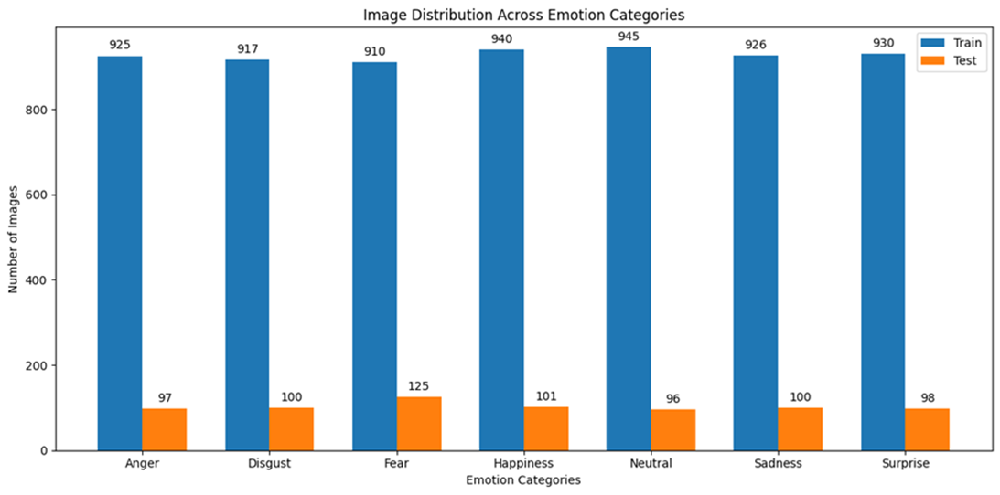

Dataset ini memiliki resolusi dan informasi warna yang lebih baik dibanding dataset FER klasik berbasis gambar *grayscale* kecil, sehingga cocok untuk *transfer learning* pada model pretrained.

**Augmentasi data (saat training):** rotasi hingga 20°, pergeseran lebar dan tinggi 0,2, serta *horizontal flip*. Setiap model menggunakan `preprocess_input` bawaannya sebelum masuk jaringan.

## 🔬 Arsitektur Model

Semua model memakai pola yang sama: *backbone* pretrained ImageNet (`include_top=False`, input 224×224×3) → `GlobalAveragePooling2D` → `Dense(512, ReLU)` → `Dropout(0.5)` → `Dense(7, softmax)`.

| Model | Ciri utama | Total parameter | Parameter terlatih (tahap 1) |
|---|---|---|---|
| **VGG16** | 13 lapisan konvolusi 3×3 dalam 5 blok (64→128→256→512→512 filter) dengan max pooling; struktur sekuensial sederhana | 14,98 juta | 266 ribu |
| **GoogLeNet** (InceptionV3) | Modul Inception: cabang paralel konvolusi 1×1, 3×3, 5×5 dan pooling yang digabung; konvolusi 1×1 menekan jumlah kanal | 22,86 juta | 1,05 juta |
| **ResNet101V2** | 101 lapisan dengan blok residual *pre-activation* (BN → ReLU → Conv) dan *skip connection* | 43,68 juta | 1,05 juta |
| **EfficientNetB2** | Blok MBConv dengan *Squeeze-and-Excitation* dan *compound scaling* (kedalaman, lebar, resolusi) | 8,49 juta | 725 ribu |

> **Catatan:** notebook `FER_GoogLeNet.ipynb` menggunakan `InceptionV3` dari Keras sebagai wakil keluarga GoogLeNet/Inception, bukan GoogLeNet (Inception v1) asli.

## 🧪 Eksperimen dan Hyperparameter

Training dilakukan dalam dua tahap: (1) *backbone* dibekukan dan hanya *head* yang dilatih, lalu (2) *fine-tuning* dengan *learning rate* lebih kecil.

| Hyperparameter | VGG16 | GoogLeNet | ResNet101V2 | EfficientNetB2 |
|---|---|---|---|---|
| Ukuran input | 224×224×3 | 224×224×3 | 224×224×3 | 224×224×3 |
| Optimizer | Adam | Adam | Adam | Adam |
| Loss | Categorical crossentropy | Categorical crossentropy | Categorical crossentropy | Categorical crossentropy |
| Batch size | 256 | 256 | 512 | 256 |
| Epoch | 30 + 30 | 30 + 30 | 30 + 30 | 30 + 30 |
| LR tahap 1 (base beku) | 1e-3 | 1e-3 | 1e-3 | 1e-3 |
| LR tahap 2 (fine-tuning) | 1e-5 | 1e-5 | 1e-4 | 1e-4 |
| Lapisan yang di-*fine-tune* | Semua | 60 lapisan terakhir (BatchNorm tetap beku) | Semua | Semua |
| Dense / Dropout | 512 / 0,5 | 512 / 0,5 | 512 / 0,5 | 512 / 0,5 |

Pengaturan umum: *mixed precision* (`mixed_float16`), `validation_split=0.1`, dan metrik *accuracy*, *precision*, *recall*, serta F1-score.

Kurva akurasi training/validasi (tahap 1 dan *fine-tuning*):

| VGG16 | GoogLeNet |
|---|---|
| 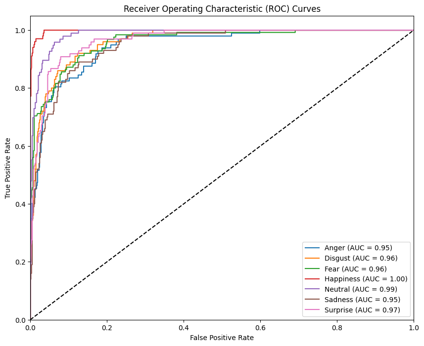 | 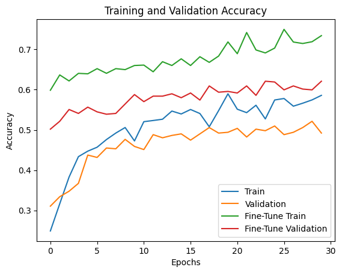 |
| **ResNet101V2** | **EfficientNetB2** |
| 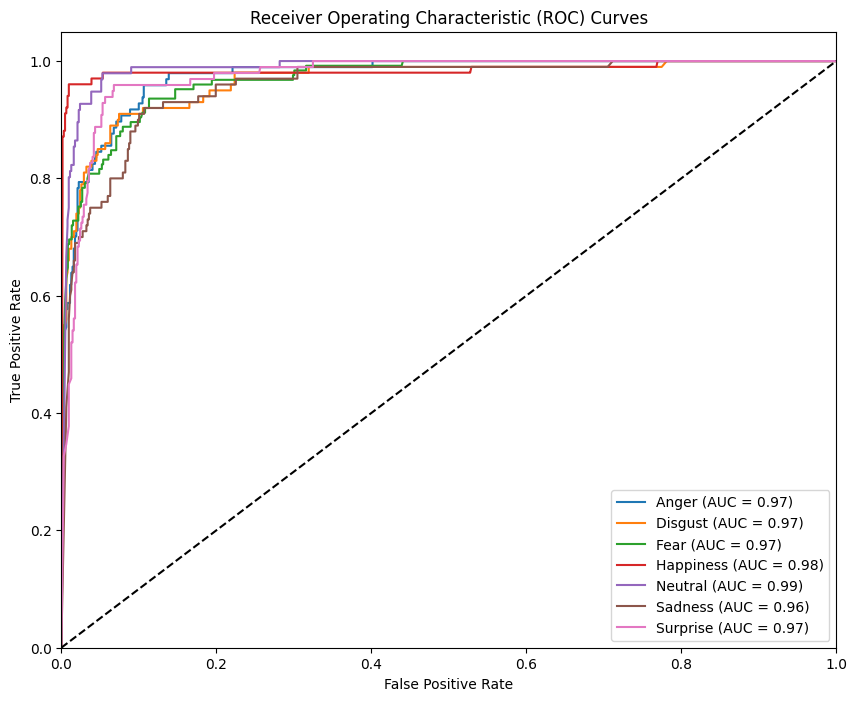 | 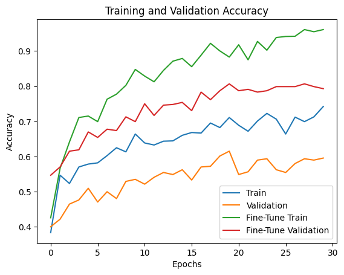 |

## 📊 Hasil

Metrik di bawah dihitung dari *confusion matrix* pada **717 gambar test** (rata-rata *macro*).

| Model | Akurasi | Precision | Recall | F1-score | Val. acc. sebelum → sesudah *fine-tuning* |
|---|---|---|---|---|---|
| **EfficientNetB2** | **83,40%** | **83,81%** | **83,54%** | **83,48%** | 59,60% → 80,34% |
| ResNet101V2 | 81,45% | 81,72% | 81,47% | 81,53% | 14,24% → 81,73% |
| VGG16 | 79,08% | 79,19% | 79,33% | 79,10% | 54,49% → 77,24% |
| GoogLeNet (InceptionV3) | 71,55% | 71,80% | 71,88% | 71,53% | 52,79% → 59,29% |

F1-score per kelas pada data test:

| Model | Anger | Disgust | Fear | Happiness | Neutral | Sadness | Surprise |
|---|---|---|---|---|---|---|---|
| VGG16 | 73% | 76% | 79% | 94% | 84% | 70% | 78% |
| GoogLeNet | 67% | 71% | 69% | 86% | 77% | 65% | 67% |
| ResNet101V2 | 80% | 80% | 80% | 94% | 88% | 74% | 76% |
| EfficientNetB2 | 79% | 83% | 80% | 96% | 89% | 78% | 80% |

**Temuan utama**
- **EfficientNetB2** unggul di semua metrik sekaligus paling ringan (8,49 juta parameter), sehingga paling efisien.
- **ResNet101V2** menempati posisi kedua meski parameternya terbanyak (43,68 juta).
- **VGG16** cukup kompetitif dengan struktur sederhana, sedangkan **GoogLeNet (InceptionV3)** paling rendah pada konfigurasi ini.
- *Fine-tuning* menaikkan kinerja di semua model, paling besar pada ResNet101V2.
- **Happiness** paling mudah dikenali (F1 94–96%), sedangkan **Sadness** dan **Anger** paling sulit.

## 📉 Confusion Matrix

| VGG16 | GoogLeNet |
|---|---|
| 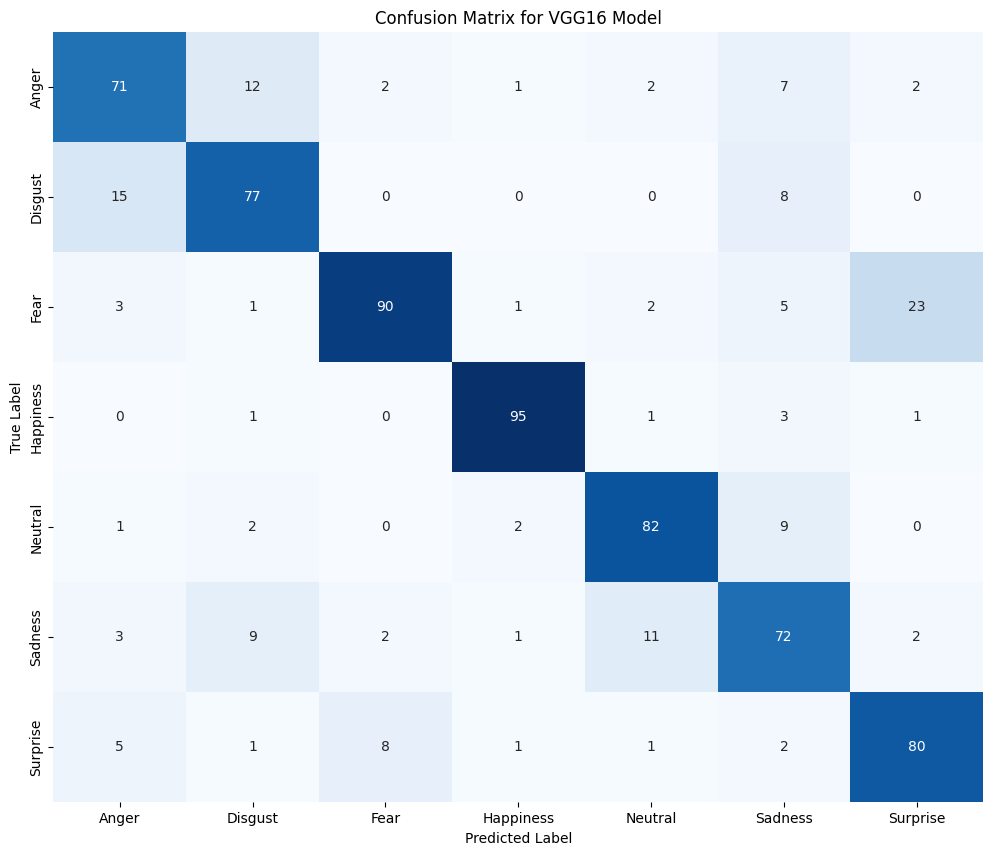 | 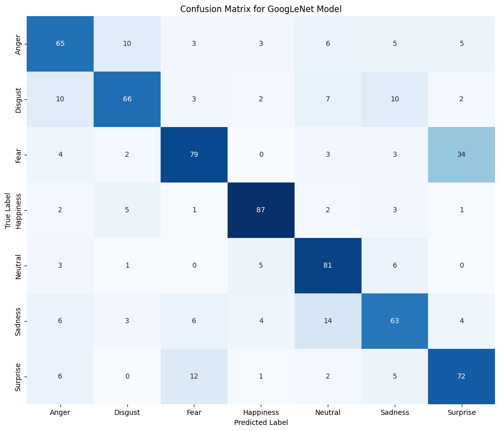 |
| **ResNet101V2** | **EfficientNetB2** |
| 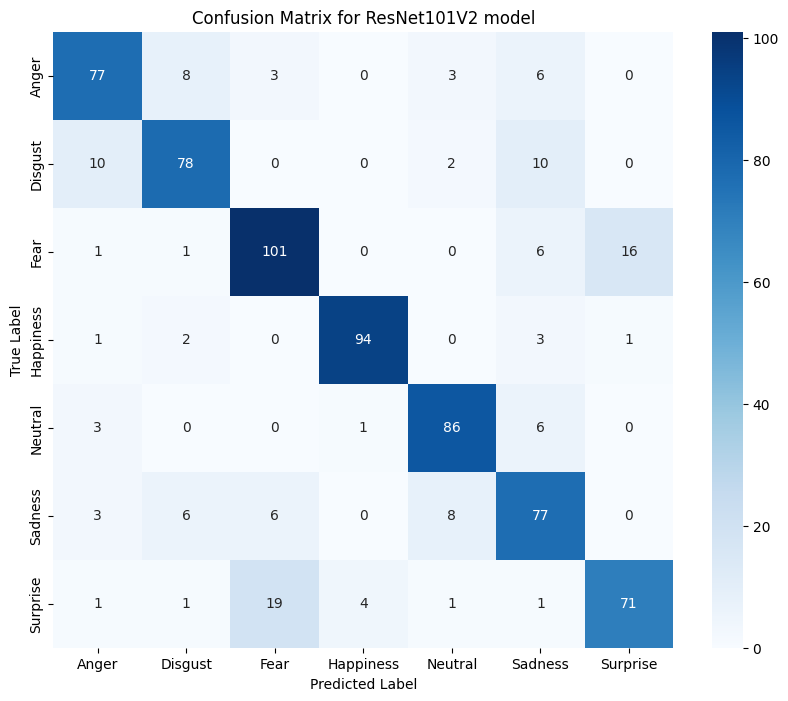 | 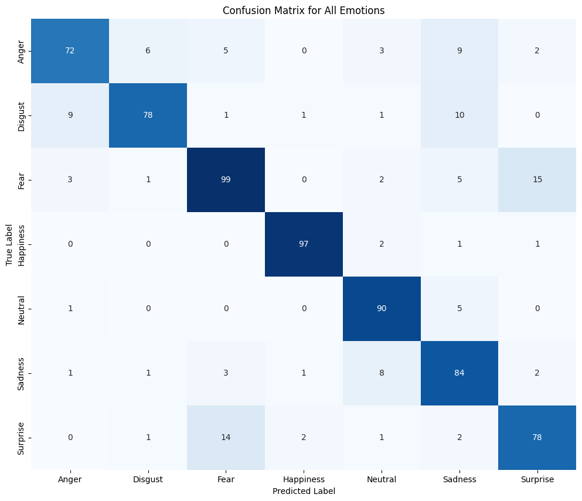 |

Pola kesalahan yang konsisten di keempat model:

- **Fear ↔ Surprise** paling sering tertukar. Fear diprediksi sebagai Surprise sebanyak 23 (VGG16), 34 (GoogLeNet), 16 (ResNet101V2), dan 15 (EfficientNetB2). Arah sebaliknya juga terjadi (8, 12, 19, dan 14).
- **Anger ↔ Disgust** saling tumpang tindih, dengan 6–15 gambar tertukar per arah.
- **Sadness → Neutral** keliru 8–14 kali, karena ekspresi sedih yang halus mirip ekspresi netral.
- **Happiness** hampir selalu benar (95, 87, 94, dan 97 dari 101 gambar).

## 📈 Kurva ROC

Kurva ROC *one-vs-rest* untuk tiap kelas dihasilkan di setiap notebook.

| VGG16 | GoogLeNet |
|---|---|
|  | 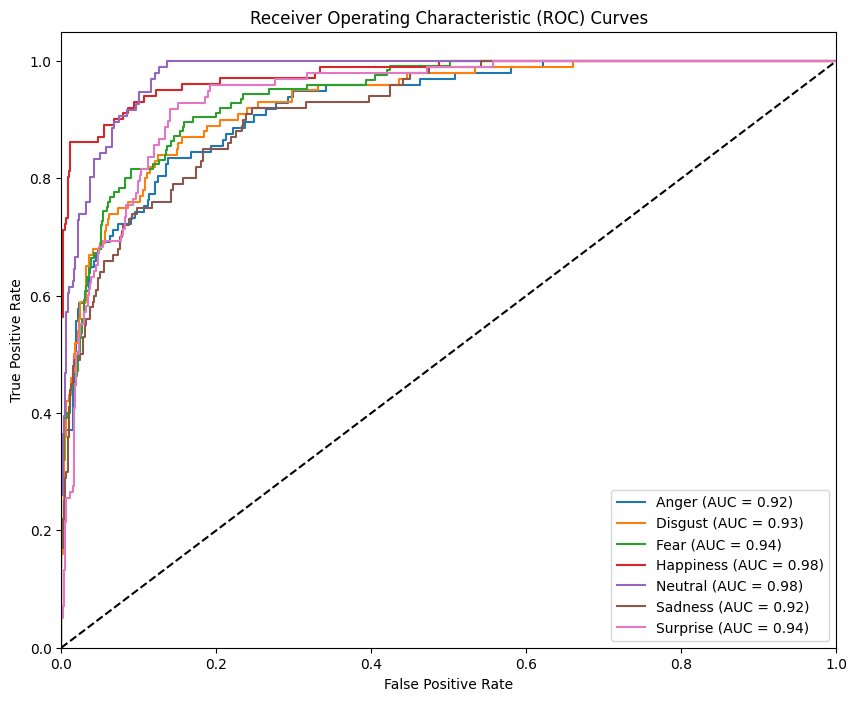 |
| **ResNet101V2** | **EfficientNetB2** |
|  | 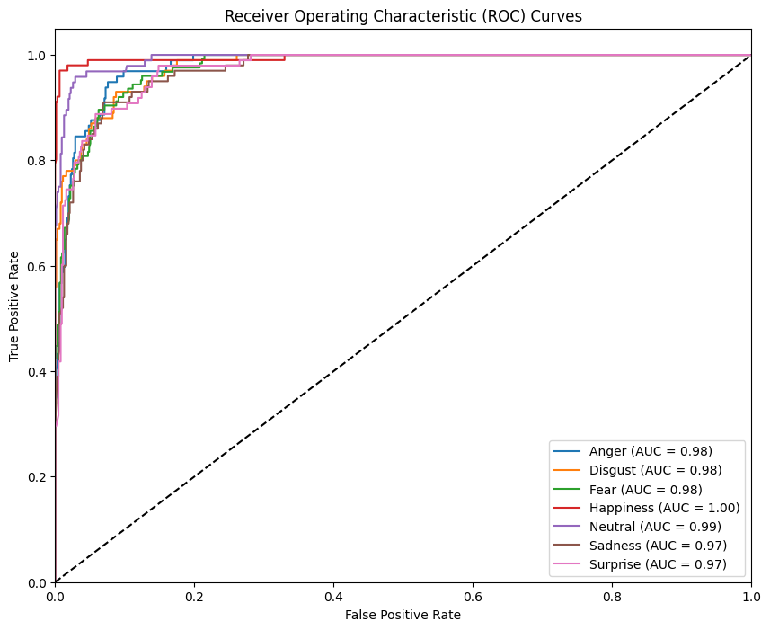 |

## 🔍 Visualisasi Grad-CAM

Notebook memakai pustaka `tf-keras-vis` untuk **Grad-CAM** dan **Grad-CAM++** per kelas emosi. Peta panas menunjukkan bagian wajah (mata, alis, mulut, dan sekitarnya) yang paling memengaruhi keputusan model, sehingga membantu menilai apakah model memperhatikan area yang relevan atau justru latar belakang.

## 🖼️ Memprediksi Emosi dari Gambar

Setelah training, model menerima satu gambar wajah dan mengeluarkan label emosinya. Potongan kode berikut diadaptasi dari notebook (contoh untuk VGG16; ganti `preprocess_input` sesuai model):

```python
import numpy as np
from tensorflow.keras.models import load_model
from tensorflow.keras.preprocessing import image
from tensorflow.keras.applications.vgg16 import preprocess_input

emotion_categories = ['Anger', 'Disgust', 'Fear', 'Happiness', 'Neutral', 'Sadness', 'Surprise']

model = load_model('FER_25_VGG16.h5', compile=False)

img = image.load_img('contoh_wajah.jpg', target_size=(224, 224))
x = preprocess_input(np.expand_dims(image.img_to_array(img), axis=0))

pred = model.predict(x)
print("Emosi terdeteksi:", emotion_categories[int(np.argmax(pred))])
```

Contoh output dari notebook VGG16: `Image: anger_716.jpg, Predicted emotion: Anger`.

## 🌍 Aplikasi Praktis

Pengenalan emosi wajah (FER) berguna untuk berbagai bidang:

- **Kesehatan:** memantau tanda stres atau depresi selama sesi konsultasi jarak jauh.
- **Pendidikan:** mengenali kebingungan atau hilangnya keterlibatan siswa pada pembelajaran daring.
- **Layanan pelanggan dan ritel:** mengukur kepuasan pelanggan.
- **Otomotif:** memantau kelelahan, frustrasi, atau kurangnya fokus pengemudi.
- **Hiburan dan interaksi manusia-komputer:** game, VR, dan robot yang responsif terhadap emosi pengguna.

## 🔧 Tools dan Teknologi

`Python` `TensorFlow` `Keras` `VGG16` `InceptionV3` `ResNet101V2` `EfficientNetB2` `NumPy` `pandas` `scikit-learn` `Matplotlib` `Seaborn` `tf-keras-vis` `Google Colab` `Google Drive`

## 🔄 Cara Menjalankan

1. Siapkan dataset FER_25 di Google Drive dengan struktur `FER_25/Train/<kelas>` dan `FER_25/Test/<kelas>`.
2. Buka notebook di `src/` melalui Google Colab (disarankan runtime GPU).
3. Sesuaikan path dataset pada sel awal, yaitu `/content/drive/My Drive/Facial_Emotion_Recognition_Project/FER_25`.
4. Jalankan sel secara berurutan: pemuatan data, visualisasi, definisi model, training tahap 1, *fine-tuning*, evaluasi, confusion matrix, ROC, penyimpanan model, lalu Grad-CAM.

## ⚠️ Keterbatasan

- **Evaluasi di notebook:** angka "Test Accuracy" yang dicetak notebook sebenarnya dievaluasi pada data *validation* (646 gambar). Karena itu, tabel hasil README ini dihitung ulang dari *confusion matrix* data test (717 gambar).
- **Preprocessing ResNet101V2:** notebook ResNet101V2 mengimpor `preprocess_input` milik EfficientNet. Ini kemungkinan menjelaskan akurasi awal yang sangat rendah (14,24%) sebelum *fine-tuning*. Disarankan memakai `tensorflow.keras.applications.resnet_v2.preprocess_input`.
- **GoogLeNet:** menggunakan InceptionV3 dengan input 224×224, bukan GoogLeNet (Inception v1) asli.
- **Hanya tujuh emosi dasar:** emosi campuran atau kompleks (sarkasme, malu, antusias, dan sebagainya) belum tercakup.
- **Konteks tidak dipertimbangkan:** bahasa tubuh, suara, dan lingkungan tidak ikut dianalisis, hanya ekspresi wajah.
- **Jenis gambar:** dataset berisi gambar berkualitas baik dan wajah menghadap depan, sehingga kinerja dapat turun pada gambar dunia nyata dengan pencahayaan, sudut, atau latar yang beragam.
- **Satu kali percobaan:** tiap model dilatih sekali dengan konfigurasi tertentu, sehingga selisih kecil antar model perlu ditafsirkan hati-hati.

## 🚧 Pengembangan Selanjutnya

- Memperbaiki *preprocessing* ResNet101V2 dan melatih ulang.
- Menguji InceptionV1 (GoogLeNet asli) dan arsitektur lain seperti EfficientNetB3–B5, ConvNeXt, atau Swin Transformer.
- Menambah data yang lebih beragam (misalnya AffectNet atau FERV39k) dan kelas emosi yang lebih kaya.
- Mengevaluasi pada data test terpisah dan memakai *callback* (*early stopping*, *learning rate scheduling*).
- Membuat antarmuka web (misalnya Gradio) agar pengguna dapat mengunggah gambar dan melihat hasil emosi secara langsung.

## 📚 Referensi

- Dataset di Kaggle: [FER_25](https://www.kaggle.com/datasets/shaikhborhanuddin/fer-25)

## 📄 Lisensi

Proyek ini menggunakan lisensi MIT. Silakan menggunakan, memodifikasi, dan mendistribusikan dengan mencantumkan kredit kepada penulis asli dan sumber referensi.

## 📬 Kontak

**[Nama Anda]**
📧 Email: [laurensiusryan11@gmail.com]

